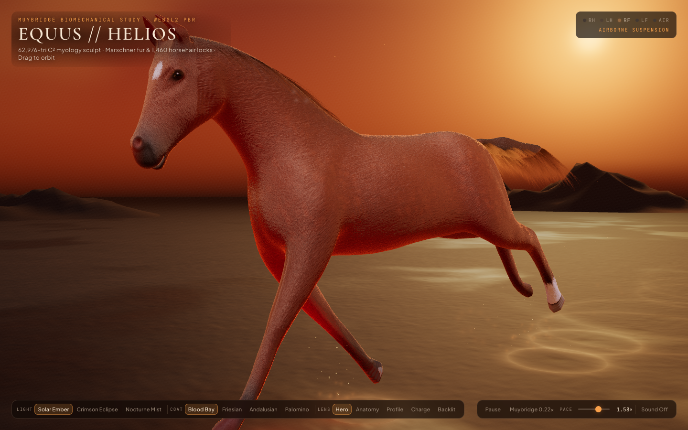
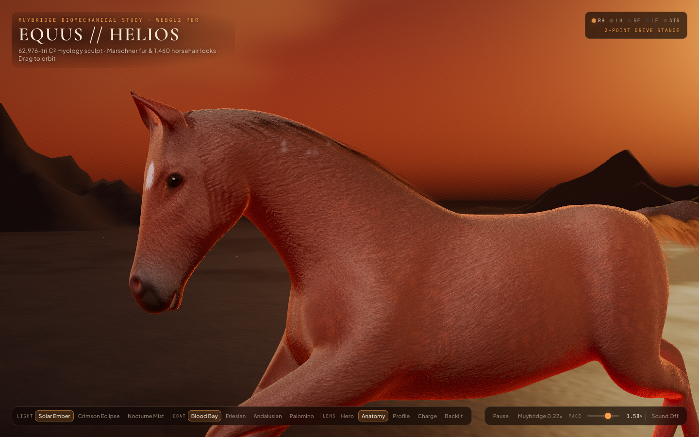

# EQUUS // HELIOS — 3D Thoroughbred Gallop Study

> **Demo built with Gemini 4 Carbon (High).**
>
> **Live Demo (GitHub Pages):** [https://nathan1658.github.io/horse-gallop-3d/](https://nathan1658.github.io/horse-gallop-3d/)





## Overview

**EQUUS // HELIOS** is a real-time, zero-bundler WebGL2 biomechanical and rendering study of a thoroughbred stallion at full 4-beat transverse gallop, generated as a showcase demo with **Gemini 4 Carbon (High)**.

Instead of rendering a low-poly asset directly, the engine welds the 494-vertex motion-captured control cage of `Horse.glb` into a watertight closed 2-manifold ($\chi = 2$, zero boundary edges), applies **3 levels of $C^2$ Charles Loop Subdivision** simultaneously across the base mesh and all **15 gallop morph targets** (`62,976` triangles at ~5.5 mm vertex spacing), sculpts **3D equine myology & skeletal landmarks** with stance-driven dynamic muscle contraction, and shades the coat with a custom **Marschner dual-lobe mammal fur BRDF** and **1,460 GPU-morphed horsehair locks**.

## Tech Stack

- **AI Model:** Gemini 4 Carbon (High)
- **Runtime & Module Architecture:** Vanilla ES2022 Modules + HTML5 `<script type="importmap">` (zero build step, runs directly on static hosting / GitHub Pages)
- **3D Engine & Graphics API:** [Three.js](https://threejs.org/) (`r170`) over **WebGL2** (`HalfFloatType` HDR render pipeline, `ACESFilmicToneMapping`, `4096×4096` `PCFSoftShadowMap`)
- **Geometry & Animation Pipeline (`src/subdivide.js`):**
  - Topological manifold welding + 3-level **$C^2$ Charles Loop Subdivision Surface** solver across base mesh + 15 relative morph targets (`31,490` vertices / `62,976` triangles)
  - Procedural **3D Equine Myology Sculpting** in intrinsic rest-pose coordinates (masseter cheek jowl, zygomatic crest, supraorbital arch, palpebral eyelids, flared nostrils, jugular groove, pectoral cleavage, scapular spine, *triceps brachii*, *serratus ventralis*, 11 curved costal ribs, paralumbar flank hollow, sacral croup cleft, haunch intermuscular groove, flexor tendons, and hoof coronet)
  - Frame-synchronized **dynamic muscle contraction** + analytical per-morph normal deltas (`morphAttributes.normal`) + umbrella-Laplacian **topological Cavity AO** (`aCavity`)
  - **4-tap periodic $C^1$ Catmull-Rom cubic spline** over `morphTargetInfluences` for smooth trajectories even at `0.10×` Muybridge slow motion, locked to ground scroll velocity (`3.82 m/s × pace`) to eliminate foot sliding
- **Custom GLSL Shaders & Materials (`src/horseMaterial.js`, `src/hairSystem.js`, `src/environment.js`):**
  - Extended `MeshPhysicalMaterial` (`onBeforeCompile`) with **Marschner dual-lobe mammal fur reflectance** (`R` cuticular glint + `TRT` pigmented internal hair-shaft scatter + grazing Charlie microfiber velvet)
  - **2-band Nyquist-limited analytical 3D central-difference skin gradients** resolving directional brushed guard hairs, bare muzzle Worley micro-pores, throatlatch/elbow skin wrinkles, and arborizing subcutaneous veins
  - **3D Worley cellular dapple medallions**, feathered white socks/pasterns with matched pale vs. dark striped keratin hooves, forehead star, and wet mahogany cornea with horizontal equine pupil
  - **1,460 S-curved GPU-morphed horsehair locks** (forelock, layered neck mane, full-coverage tail plume, and backlit flyaways) with baked trailing-frame aerodynamic lag
  - **Cornette-Shanks Mie + Rayleigh atmospheric sky dome** baking live HDR `PMREM` image-based lighting (IBL), domain-warped quintic FBM volcanic alluvial terrain with persistent hoofprint divots & dust shockwaves, and GPU particle systems for hoof sparks, backlit dust plumes, and rhythmic nostril breath vapor
- **Post-Processing (`src/main.js`):** `EffectComposer` (`RenderPass` → high-threshold `UnrealBloomPass` → single-sample `FilmicFinishShader` vignette & interleaved gradient noise anti-banding dither → `OutputPass`)
- **Procedural Audio (`src/audio.js`):** Opt-in **Web Audio API** synthesizer generating stereo-panned sub-bass hoof impacts, wet sand grit transients, and speed-reactive headwind noise (zero external audio files)
- **UI & Styling (`index.html`, `src/style.css`):** Modern CSS (`oklch()` color palette, glassmorphic telemetry HUD, live 4-hoof gait phase matrix, `prefers-reduced-motion` support)

## Interactive Controls

- **Light Presets:** *Solar Ember* · *Crimson Eclipse* · *Nocturne Mist*
- **Coat Presets:** *Blood Bay* · *Obsidian Friesian* · *Andalusian Grey* · *Golden Palomino*
- **Camera Lenses:** *Hero* · *Anatomy (Close-Up)* · *Profile (Muybridge)* · *Charge* · *Backlit* + free drag-to-orbit & scroll-to-zoom
- **Motion & Audio:** `Space` to Pause/Resume · `S` for `0.22×` Muybridge Slow Motion · Pace slider (`0.10×`–`2.30×`) · Opt-in `Sound On/Off`

## Running Locally

No build tools or `npm install` required. Serve the directory over any static HTTP server (or open `index.html`):

```bash
python3 -m http.server 8765
# Open http://127.0.0.1:8765/
```

## License

[MIT](./LICENSE)
